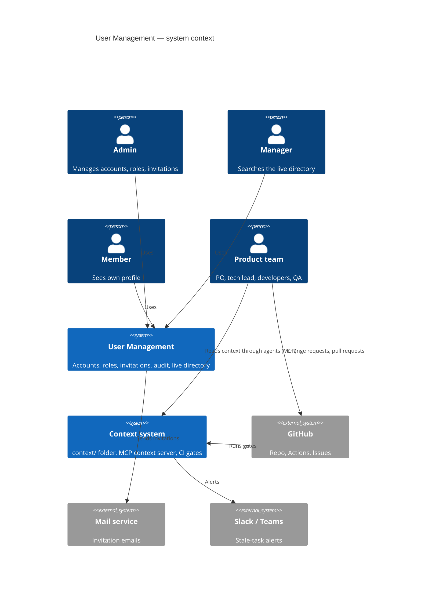
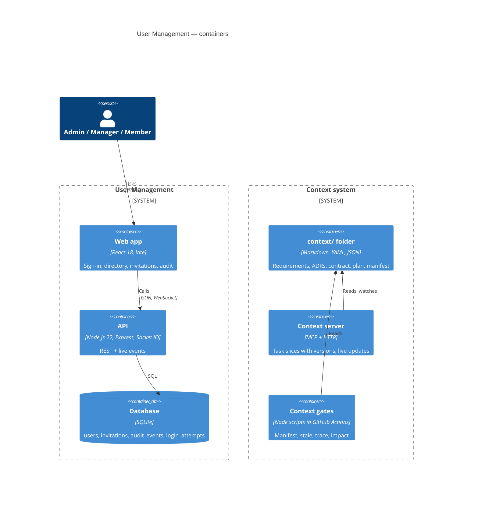
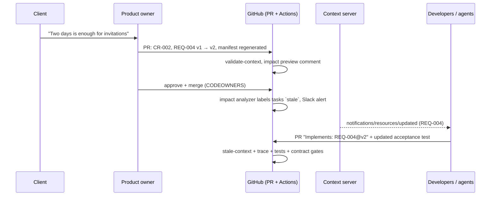

# Architecture (C4) — Mermaid views

The source of truth is `workspace.dsl` (Structurizr). These Mermaid views render directly on GitHub.

## Level 1 — System context

## Level 2 — Containers

## Request flow: a requirement change

